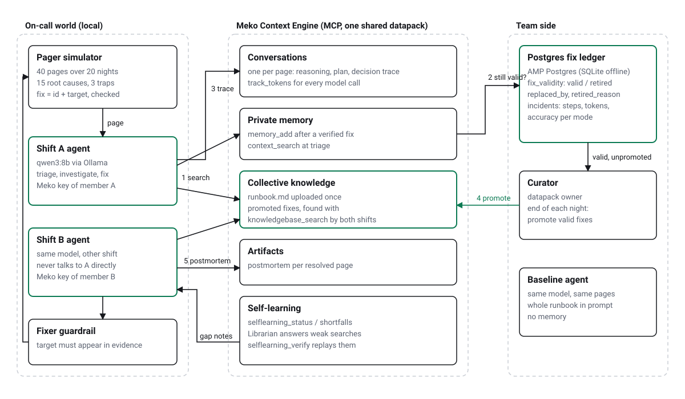

# Night Shift

On-call agents that never solve the same incident twice, even when a different shift caught it the first time.

Night Shift is a two-shift incident response team built on the [Meko Context Engine](https://mekodata.ai).
Shift A and shift B are two Meko members with their own keys.
When one shift fixes a page, the fix becomes a private memory.
When the agent gives up, the on-call human fixes the page and their note goes into Meko the same way, so the agents also learn from people.
At the end of the night a curator (the datapack owner) promotes every fix the ledger still marks valid, and the other shift finds it at triage.
A Postgres ledger records whether each remembered fix still works, so a fix that stopped working is retired instead of being applied again.

Theme: **02 Agentic support: Never Solve It Twice** (internal SRE support).

- Demo video (4:42): https://kangraemin.github.io/nightshift-meko/docs/video/nightshift-demo.mp4
- Replay a live run in the browser: https://kangraemin.github.io/nightshift-meko/dashboard/
- Slides: [docs/deck.pdf](docs/deck.pdf)



## What it measures

The same 40 pages are answered twice, by the same local model (qwen3:8b through Ollama), in the same order:

- **Without memory**: the whole team runbook is pasted into the prompt. This is what most teams do today.
- **Night Shift**: no runbook in the prompt. The agent searches Meko first, checks each hit against the Postgres ledger, then investigates.

The incidents come from a deterministic simulator, so nobody grades the answers by opinion.
A page counts as resolved only when the agent applies the right fix to the right target on the right service.
Targets are company-specific (a pgbouncer pool name, a JVM options key, a node name), so the model cannot guess them from general knowledge.
It has to find them in diagnostic output or in a memory.

The 40 pages include:

- 12 first-seen causes, where memory cannot help yet
- 25 repeats of a cause some shift already solved
- 3 traps: the alert looks exactly like an old one, but the old fix no longer works

<!-- RESULTS -->
## Results

Live runs: 3 seeds (each seed shuffles which shift gets which page), two real Meko members, AMP Postgres ledger, qwen3:8b. Every number below comes from the `summary.json` of a run in `results/published/`.

| Pages | Runbook in prompt: resolved | Night Shift: resolved | Steps per page | Tokens per page |
|---|---|---|---|---|
| First-seen causes (12) | 56% (67% / 58% / 42%) | **61%** (67% / 58% / 58%) | 8.4 → 7.2 | 11,173 → 8,948 |
| Repeats (25) | 56% (56% / 60% / 52%) | **92%** (96% / 92% / 88%) | 8.7 → 2.8 | 11,662 → 3,972 |
| Traps (3) | 33% (33% / 33% / 33%) | 33% (33% / 33% / 33%) | 9.7 → 9.4 | 13,358 → 13,945 |
| All pages (40) | 54% (57% / 57% / 48%) | **78%** (82% / 78% / 75%) | 8.7 → 4.6 | 11,642 → 6,213 |

Cells show the mean over seeds, with each seed in brackets.

What the memory layer did, summed over the live runs:

- 61 fixes learned, 61 promoted by the curator, 28 retired by the ledger. The curator promotes every fix the ledger still marks valid; there is no human review step.
- 26 pages the agent lost were fixed by the on-call human, and their note went into Meko the same way. A later page started from one of those human notes 32 times and was resolved 28 times.
- Retired fixes were refused 53 times. A fix the ledger had already retired was still applied 10 times on 8 pages: 7 of those pages were resolved, because the old cause had really come back and a diagnostic printed the same target (the fresh-evidence rule); the rest were wasted retries.
- The librarian answered 40 searches that Meko scored as weak matches. Replaying them, `selflearning_verify` moved 34 to a better match band, 27 of them to the high band (this is Meko's own retrieval score, not a page outcome).

### Where does the gain come from?

Same Night Shift agent and pages, offline (in-process Meko stand-in, SQLite ledger), 3 seeds, three switches:

| Night Shift lane, offline | First-seen | Repeats | All pages | Steps per repeat |
|---|---|---|---|---|
| Runbook search only, nothing remembered (`--no-memory`) | 64% | 64% (64% / 60% / 68%) | 62% | 7.8 |
| Private memory only, no sharing (`--no-share`) | 67% | 71% (76% / 60% / 76%) | 68% | 6.0 |
| Shared through Meko | 61% | 91% (92% / 92% / 88%) | 78% | 3.3 |

- The first row still searches the runbook in Meko instead of pasting it, so it isolates retrieval from memory. Its first-seen score is the share of the gain that comes from a shorter, focused prompt rather than from remembering.
- 13 of the 25 repeats first happened on the other shift. Without sharing, those start from scratch.

### What did not improve

- Traps: Night Shift resolved 33% of trap pages, the runbook lane 33%. The ledger stops the stale fix, but finding the new cause is still up to an 8B model.
- The ledger can also over-block: when the old cause really returns but the agent never runs the diagnostic that prints the target, the retired fix stays refused and the page is lost (INC-33 in two of the three live seeds).
- First-seen pages: memory cannot help there, yet Night Shift scored 61% against 56% live. The no-memory control scores 64% offline, so this part of the gain comes from retrieving a few runbook sections instead of pasting the whole runbook, not from the team's memory.
<!-- /RESULTS -->

## How Meko is used

| Meko feature | Where | Why |
|---|---|---|
| `conversation_create` + `conversation_add_message` (reasoning, plan) | every page | Decision trace for each page in the portal |
| `track_token_usage` | every page | local-model tokens show up next to the trace |
| `context_search` | triage | the shift's own memories, logged for self-learning |
| `knowledgebase_search` | triage | the team's collective knowledge: runbook + promoted fixes |
| `memory_add` | after a verified fix, or a human's fix of a lost page | evidence, root cause, fix, target, which shift, which page, agent or human |
| `memory_promote` | curator, end of night | only the datapack owner can promote; contributors cannot |
| `artifact_put` | after a verified fix | postmortem markdown per page |
| `knowledgebase_upload_document` | run setup | the team runbook (with its known gaps) |
| `selflearning_status` / `selflearning_shortfalls` / `selflearning_verify` | Librarian, every 5 nights | answer weak searches, then replay them to prove they improved |
| datapack sharing (Contributor role) | `scripts/share_datapack.py` | shift B is a real second member, not a second agent id |

### Postgres inside the context

Retrieval alone cannot tell a good memory from a stale one.
Night Shift keeps a small ledger next to the memories (AMP Postgres in the live run, SQLite offline):

- `fix_validity(memory_id, fix_id, service, symptom, learned_by, status, promoted, retired_reason, replaced_by)`
- `incidents(mode, inc_id, shift, cause, first_seen, trap, resolved, steps, tokens_in, tokens_out, seconds, stale_fix_applied)`
- `services(name, owner_shift)`

Every memory hit is joined with `fix_validity` before the model sees it, and labelled VALID, RETIRED or unverified.
When a remembered fix fails, the ledger retires it with the reason and later points `replaced_by` at the new memory.
From then on the Fixer refuses that fix and target for the same alert, unless a diagnostic command in the current page prints that exact target.
An old cause can come back (a rollback to the same healthy release, the same flag), and fresh evidence beats an old retirement.
Promoted memories are evicted from private memory and cannot be edited over MCP, so the ledger is how the team keeps memory honest.

### The Fixer guardrail

Both modes share one rule: a fix is only applied to a target that has appeared in diagnostic output or in a memory shown to the agent.
A fix that already failed in the same page is refused.
This stops a small model from guessing names, and it keeps the comparison fair: neither mode can win by luck.

## Run it

Offline needs no account (in-process Meko stand-in with the same interface, SQLite ledger):

```bash
make setup            # pip install, ollama pull qwen3:8b
make demo-offline     # 40 pages, both modes, about 45 minutes on an M-series Mac
make dashboard        # then open the URL it prints
make test             # guardrail and ledger tests, no model needed
```

Live run (two Meko members sharing one datapack, AMP Postgres ledger):

```bash
export MEKO_API_KEY=...            # member A, datapack owner = curator
export MEKO_B_API_KEY=...          # member B
export MEKO_EMAIL=... MEKO_PASSWORD=... MEKO_B_EMAIL=... MEKO_B_PASSWORD=...
export NIGHTSHIFT_DATAPACK_ID=$(python scripts/share_datapack.py nightshift-s1 | tail -1)
export NIGHTSHIFT_PG_HOST=... NIGHTSHIFT_PG_PORT=... NIGHTSHIFT_AMP_PASSWORD=...
make demo SEED=1
```

Each seed gets a fresh datapack because promoted memories cannot be deleted over MCP.

Replay any run in the browser: `dashboard/index.html?run=../results/published/<run_id>/events.jsonl`.

## Repository

- `nightshift/sim.py`: incident simulator, 15 causes, 40-page schedule, deterministic grading
- `nightshift/agents.py`: baseline agent, Night Shift agent, human handback, curator, librarian, Fixer guardrail
- `tests/`: Fixer refusals, the fresh-evidence rule, ledger learn/retire/replace, human handback
- `nightshift/meko.py`: minimal MCP client (streamable HTTP, no SDK) and the offline stand-in
- `nightshift/ledger.py`: Postgres / SQLite ledger
- `nightshift/run.py`: benchmark runner, writes `events.jsonl`, `incidents.json`, `summary.json`
- `dashboard/`: split-screen replay of a recorded run
- `runbook/runbook.md`: the team wiki both modes start from
- `scripts/`: architecture diagram, datapack sharing, results table (`results_md.py`), deck (`deck.py`), demo video (`record_demo.py` with a local Kokoro voice in `tts.py` and a generated music bed in `bgm.py`)

## Limits

- The incidents are simulated. Real pages have messier evidence.
- One 8B local model. A larger model would solve more first-seen pages in both modes.
- No Anthropic or OpenAI API is called anywhere. Meko does its own memory extraction on its side.

License: Apache 2.0
